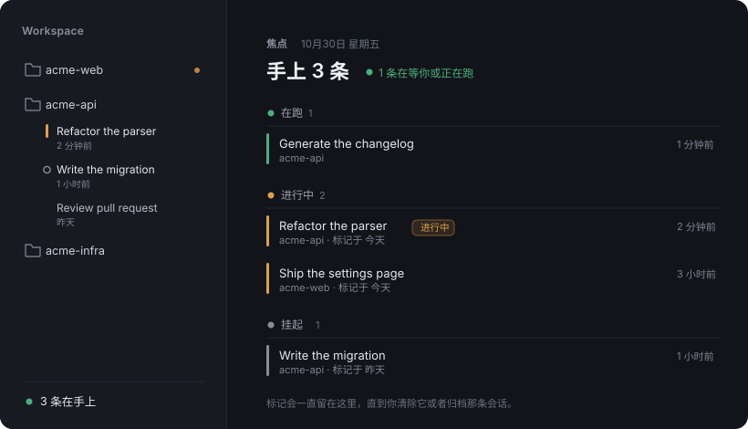

# dsh-session-focus

Focus marks for [DeepSeek Harness](https://github.com/deepseek-ai/deepseek-harness).

The sidebar already tells you which Session is running, which one is waiting for an answer, and which one has something new. What it cannot know is **what you decided to work on**, and **how long a Session has been sitting there**. When you keep twenty workspaces open, that gap is where tasks get lost.

This plugin adds the missing layer. It does not replace the sidebar, add a floating ball, or open a window you have to remember to check.

## What it does

<p align="center">
  
</p>

*Illustration, not a screenshot: the names above are invented.*

**Mark a Session, one click, three places.** The 16px cell before a Session's title cycles `none → focus → parked → none`. The same cycle is on the hover card and on a chip in the conversation header.

- **Focus** — an amber bar. This is what you are pushing on now.
- **Parked** — a hollow ring. Waiting on someone, or set aside on purpose.

**A count that survives collapse.** Folding a workspace group hides every row inside it, marks included. The folder name gets a small dot when it holds something, and hovering that row turns the dot into the count. There is also a readout at the foot of the sidebar — `● 6 条在手上` — which opens the full list when clicked.

**A page, when you want everything.** The panel icon in the sidebar strip opens a cross-workspace list grouped by state. It reads the shipped `useSessionStatus` snapshot, so its groups are exactly the ones the sidebar's own status dots mean: waiting for approval, waiting for a review, waiting for an answer, running, finished-unread. Your own marks come after those.

## Install

```bash
dsh plugin --profile <profile> add dsh-session-focus
```

Or from a local checkout:

```bash
dsh plugin --profile <profile> add /absolute/path/to/dsh-session-focus
```

In the Desktop app, install by absolute path from the Plugins page.

## How it is built

Client-side only. Marks live in `localStorage` under `dsh-focus.marks.v1` (the key predates the package rename and is kept so existing marks survive), synced across tabs through a `BroadcastChannel`. The Host half registers no route, no tool and no service — there is nothing to authenticate, migrate, or clean up. Undoing a wrong mark costs one click.

The workspace dot is a stylesheet rule keyed on the row's own `data-row-key`, not an injected node. That matters: React drops foreign nodes on every commit, and re-adding them blinks forever. A `::after` rule has no lifecycle of its own.

## Limits

- Marks are per browser. Another machine, or another browser, starts empty.
- The workspace-name dot depends on a structural hook the shipped sidebar publishes (`data-row-key="workspace:<id>"`). If that changes upstream, the dot disappears; everything else keeps working.
- The conversation header carries no `workspaceId`, so workspace ownership is resolved by normalizing the Session's `cwd` against the workspace registry paths.

## License

MIT

---

# 中文说明

给 DeepSeek Harness 加上「我这一轮到底在做哪几条会话」这一层。

**标记**：会话标题前那 16px 格子点一下循环 `无 → 进行中 → 挂起 → 无`，琥珀竖条是进行中，空心环是挂起。悬浮卡和会话头的胶囊也能切换。

**折叠可见**：工作区收起时，文件夹名字后面会有个小圆点表示里面有东西，鼠标移上去变成条数。侧边栏底部还有一行 `● 6 条在手上`，点它直接打开完整列表。

**完整列表**：侧边栏面板区的靶心图标进入，按状态分组，其中系统状态（等待审批、计划待审、等待回答、在跑、已完成未查看）直接读原生 `useSessionStatus`，和你熟悉的状态点完全一致。

**实现**：纯客户端，标记存在 `localStorage`，多标签用 `BroadcastChannel` 同步。Host 侧不含任何路由、工具或服务。
